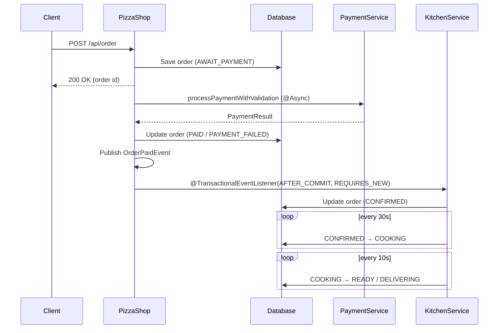

# PizzaShop API

## Motivation

A project with a focus on **async processing and transactional interactions**
under a familiar domain - a pizzeria.

The goal is **not** a production-ready CRUD API with a full admin panel.
The goal is to **integrate several patterns in combination** and see how they
behave together:

- Asynchronous payment processing with `CompletableFuture`
- Event-driven kitchen flow via `@TransactionalEventListener`
- Transaction propagation: `REQUIRES_NEW` for async recalculation
- Optimistic locking on shared entities
- Custom price calculation logic

Each component is small. The interesting part is the combination.

## Architecture

Monolith - a single Spring Boot application with PostgreSQL.
Async work is done via thread pools inside the application.



**Flow:**

1. Client authenticates (JWT), adds pizzas to the cart.
    
2. Client creates an order from the cart. Order is saved with status `AWAIT_PAYMENT` and returned immediately.
    
3. Payment is processed asynchronously in a separate thread pool.
    
4. On payment success:
    
	- Order -> `PAID`
    - Cart cleared
    - `OrderPaidEvent` published
    - `KitchenService` listens via `@TransactionalEventListener(AFTER_COMMIT)` + `@Transactional(REQUIRES_NEW)` -> order -> `CONFIRMED`
        
5. On payment failure:
    
    - Order -> `PAYMENT_FAILED`
    - Cart **not** cleared (client can retry)

6. Cooking is simulated by two scheduled jobs:

    - `CONFIRMED -> COOKING` every 30s
    - `COOKING -> READY` (pickup) or `COOKING -> DELIVERING` (delivery) every 10s
        
## Technologies

- Java 21, Spring Boot
- Spring Data JPA, Spring Security (JWT)
- PostgreSQL
- Testcontainers, JUnit 5, Mockito
- Docker

## Requirements

- Java 21+
- Docker (for `docker compose up` and Testcontainers)

## Quick start

```bash

git clone https://github.com/Egrius/pizzaShop

cd pizzaShop

docker compose -f ./docker-compose.yaml up
  
```

Once running:
- Swagger UI: http://localhost:8080/swagger-ui.html

## What's interesting inside

### 1. Async payment processing

`OrderService.createOrderFromCart()` returns immediately with the order in status  
`AWAIT_PAYMENT`. Payment runs in a separate thread pool (`paymentProcessingExecutor`),  
so the HTTP thread is not blocked while the application responds.

```java

paymentService.processPaymentWithValidation(paymentDetails)
    .whenComplete((response, throwable) -> {
        if (throwable != null) {
            self.handlePaymentResult(orderId, null, throwable, ...);
        } else {
            self.handlePaymentResult(orderId, response, null, ...);
        }
    });
```

`handlePaymentResult` is called via `self` (`@Lazy @Autowired OrderService` reference),  
Calling through `self` goes through the proxy, and the transaction is applied.

### 2. Event-driven kitchen flow

After payment succeeds, `OrderPaidEvent` is published. `KitchenService.acceptPaidOrder(...)`
listens with `@TransactionalEventListener(phase = AFTER_COMMIT)` and
`@Transactional(propagation = REQUIRES_NEW)`:

- The listener triggers **only after** the payment transaction commits.
- It runs in its **own** transaction - safe to modify the order even if the outer transaction is already done.
- If the payment transaction rolls back, the listener doesn't trigger and the order stays `AWAIT_PAYMENT`.

### 2.1. Cooking is simulated with two scheduled jobs

`KitchenService` also runs two `@Scheduled` methods:

- `startCookingConfirmedOrders()` - every 30s, moves `CONFIRMED -> COOKING`
  and records `startedCookingAt`.
- `checkOrdersToComplete()` - every 10s, moves `COOKING -> READY` (pickup)
  or `COOKING -> DELIVERING` (delivery).

The full lifecycle is: `AWAIT_PAYMENT -> PAID -> CONFIRMED -> COOKING -> READY/DELIVERING`

### 3. Async price recalculation with `REQUIRES_NEW`

When an ingredient's price changes, pizzas that use it must be recalculated:

- `IngredientService.updateIngredient` detects the price change and publishes `IngredientPriceChangedEvent`.

- `PizzaPriceRecalculationService.recalculatePricesForIngredientAsync` is annotated with  both `@Async("priceRecalculationExecutor")` and  `@Transactional(propagation = REQUIRES_NEW)`.

`REQUIRES_NEW` is needed to run recalculation in its own transaction to not be rolled back by the caller.

### 4. Optimistic locking

Both `Ingredient` and `Pizza` have a `@Version` field. Two concurrent updates
to the same row: the second one fails with `OptimisticLockingFailureException`
instead of silently overwriting.

### 5. Custom price calculation

`PriceCalculator` is real business logic, not just `price * quantity`:

- Ingredients cost - sum of `ingredient.price * weight_kg`.
    
- Dough and sauce costs - percentage of the total pizza weight.
    
- Markup - 80% on top of cost.
    
- Rounding to `.90` (e.g., `12.34` -> `12.90`).
    
- Minimum price per size (`SMALL` / `MEDIUM` / `LARGE`).
    
### 6. Query optimization with projections

`PizzaService.getPizzaCardsSlice(...)` uses a JPA projection (`PizzaCardProjection`)  
instead of loading the full `Pizza` entity with ingredients and sizes.  
Returns a `Slice`, not a `Page` - no `totalElements` count, cheaper for infinite  
scroll.

### 7. Cart inserts

`CartService.addToCart(...)` - if the same pizza + size is already in the cart, quantity  
is incremented. Otherwise a new cart item is created. 

## Tests

Unit tests (Mockito) for services and controllers, integration tests with Testcontainers (real PostgreSQL, real HTTP). The async payment flow is covered twice: `OrderServiceUnitIT` mocks the payment gateway for deterministic outcomes, `OrderServiceFlowIT` runs against the real (simulated) service to test the full happy/failure path with concurrent orders.

Run: `./gradlew test`

## Admin functionality

A minimal admin surface - enough to demonstrate role-based access,
optimistic locking, and cascading price recalculation across a graph of related rows. It is **not** a full admin panel.

The most interesting admin endpoint is `PUT /api/admin/products/{id}` (update ingredient).
It combines three things at once: optimistic locking via `@Version` on `Ingredient`, an `IngredientPriceChangedEvent` published on price change, and an async `REQUIRES_NEW` recalculation that affects every pizza using the ingredient. A single PUT can touch N pizzas.

Deletes are guarded: `DELETE /api/admin/products/{id}` refuses if the ingredient is used by any pizza; same for size templates. Pizza deletion, in contrast, cascades to its join rows (`pizza_ingredients`, `pizza_sizes`) but leaves the warehouse (`ingredients`, `size_templates`) intact.

## Authentication

1. **Register**: `POST /api/auth/register`
   Body: `{ fullName, email, rawPassword, phone }`

2. **Login**: `POST /api/auth/login`
   Body: `{ email, rawPassword }` -> returns JWT
   
3. Attach to every request:
   `Authorization: Bearer <token>`

**Password storage**: BCrypt via `PasswordEncoder`.

**Roles**:
- `CUSTOMER` - cart and orders.
- `ADMIN` - everything under `/api/admin/**`.

To promote a user to admin, update `user.role` directly in the DB - there is
no user-CRUD endpoint for admin (see Restrictions).

## Restrictions and compromises

- **No user management** - neither admin-side nor self-service. Only
  `register` / `login` / `logout` are exposed. `UserService` implements
  `changeFullName`, `changePassword`, `deleteUser`, `getUserById`, but no
  controller wires them up. Intentional for the MVP scope - the focus is on
  async and transaction patterns. `UserController` would be the natural
  next step.

- **No `/me` endpoint** - `AuthController.GET /me` is written but commented out.

- **No order cancellation flow** - not implemented.

- **No real payment gateway** - `PaymentService` simulates it with a 2–4s network  delay and a 70% success rate.

- **Cooking timing** - `KitchenService.checkOrdersToComplete(...)` currently
  uses a hardcoded 1-minute interval instead of `order.getMaxTimeToWait()`.
  Should be a configurable property (test profile override).

- **`TestController`** (`/api/test/**`) is a debug helper for JWT checks.
  Should be removed before any real deployment.

- **Monolith, not microservices** - the focus was on async and transaction patterns,  not on distributed systems.

## Status

MVP. Core flows done: auth, cart, order, async payment, kitchen with scheduled
cooking, admin CRUD, async price recalculation, optimistic locking.

Not implemented: user management, order cancellation, payment gateway,
frontend.
